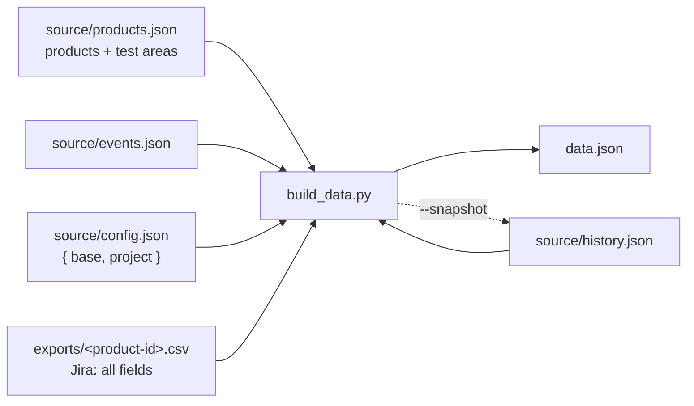

# Data pipeline

`data.json` is the bundled sample the store starts from. You don't edit it by hand. It is **built** by a Python script that uses only the standard library and makes no network calls.

<Source path="tools/build_data.py" />



## Usage

```bash
python3 tools/build_data.py                 # writes data.json
python3 tools/build_data.py --snapshot      # also appends today's coverage to source/history.json
python3 tools/build_data.py --today 2026-11-14 --out /tmp/data.json
```

| Flag | Default | Purpose |
| --- | --- | --- |
| `--src` | `tools/source` | Folder that holds the four JSON sources |
| `--exports` | `tools/exports` | Folder of Jira CSV exports, one per product |
| `--out` | `data.json` (repo root) | Output path |
| `--today` | today's date | Overrides the date, for reproducible builds |
| `--snapshot` | off | Replaces or adds today's entry in `history.json` |

A product with no CSV export prints a `note:` and contributes no findings. It is not an error.

## Jira CSV format

In Jira, export each product's vulnerability filter with **Filters → your filter → Export → CSV (all fields)**, and save the file as `tools/exports/<product-id>.csv`. The `<product-id>` must match a key in `products.json`.

Columns are matched by header name, case-insensitively:

| Column | Required | Used for |
| --- | --- | --- |
| `Issue key` (or `Key`) | ✓ | Finding id. Must match `PROJECT-123` |
| `Summary` | ✓ | Title (cut to 200 characters) |
| `Status` | | Mapped to a finding status (below) |
| any header containing `severity` | | Severity (falls back to `Priority`) |
| `Created` | | `found` |
| `Updated` | | `readyDate` for retests, and `closed` as a fallback |
| `Resolved` | | `closed` |
| `Due Date` | | `due`. If empty, it is worked out from the severity |
| `Labels` (any number) | | `late-finding` in any label sets `late: true` |

Dates can be ISO (`2026-11-12`) or Jira-style (`12/Nov/26 10:30 AM`).

### Mapping rules

| Jira value contains… | Becomes |
| --- | --- |
| `crit`, `blocker`, `highest` | Critical |
| `high`, `major` | High |
| `med`, `normal` | Medium |
| anything else | Low |

| Jira status contains… (first match wins) | Becomes |
| --- | --- |
| `retest`, `verify`, `verification` | Ready for Retest |
| `risk accept` | Risk Accepted |
| `won't` / `wont` | Won't Fix |
| `reject`, `invalid`, `duplicate` | Rejected |
| `clos`, `done`, `resolv`, `fixed` | Closed |
| `in fix`, `progress`, `fixing`, `develop` | In Fix |
| `triage` | Triaged |
| anything else | Open |

:::warning[Two copies of the fix deadlines]
The script has its own `SEV_DAYS = {"Critical": 7, "High": 30, "Medium": 90, "Low": 0}`. If you change `SEVERITY_DAYS` in `lib/sop.ts`, change this table too.
:::

## After a rebuild

Browsers that already have saved state keep showing it. To load the rebuilt `data.json`, open the account menu and choose **Reset sample data**. That clears `localStorage`, so use **Export JSON** first if there are edits to keep.
