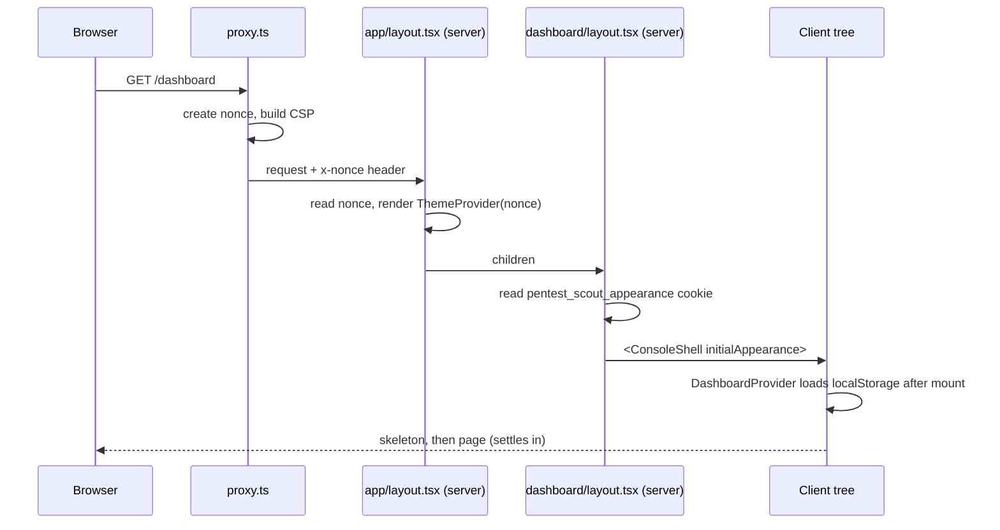

# Architecture overview

Pentest Scout is a Next.js 16 App Router application. Server components handle the parts the server should own: the CSP nonce, the appearance cookie, the database. Every interactive screen is a client component that reads from a single client-side store.

## Request path



1. **`proxy.ts`** runs on every page request (it skips `/api`, static assets, and prefetches). It makes a nonce, sets the CSP and the security headers, and passes the nonce on as `x-nonce`. See [Security](/architecture/security).
2. **`app/layout.tsx`** (server) reads `x-nonce` with `await headers()` and passes it to `ThemeProvider`, so the inline theme script from next-themes is allowed by the CSP. It loads Figtree and Geist Mono through `next/font`.
3. **`app/dashboard/layout.tsx`** (server) reads the `pentest_scout_appearance` cookie with `await cookies()`. The shell is rendered in the right appearance on the first paint, with no flash.
4. **`ConsoleShell`** (client) mounts `DashboardProvider`, `AppearanceProvider` and the sidebar frame. It shows a skeleton until the store has loaded, then settles each route in (keyed by pathname).

## Provider tree

```text
<html>                                   app/layout.tsx
  ThemeProvider (next-themes, nonce)     light/dark + "D" hotkey
    QueryProvider (TanStack Query)       server-state cache, ready for the DB layer
      TooltipProvider
        {page}
        Toaster                          sonner, bottom-right
          └─ /dashboard/*                app/dashboard/layout.tsx
             ConsoleShell
               DashboardProvider         lib/store.tsx: data + actions
                 AppearanceProvider      default | dark-sidebar
                   SidebarProvider → AppSidebar + SidebarInset(SiteHeader, page)
```

`QueryProvider` is mounted but nothing uses it yet. It is there for when features read from the database through route handlers or server actions. Its defaults are `staleTime: 60s` and no refetch on window focus. One client is created per server render and one per browser tab.

## Routes

| Route | File | What it renders |
| --- | --- | --- |
| `/` | `app/page.tsx` | Client redirect to `/login`, or `#p-<id>` → `/dashboard/products/<id>` (old links) |
| `/login` | `app/login/page.tsx` | Sign-in. Any well-formed credentials continue (no IdP yet) |
| `/dashboard` | `app/dashboard/page.tsx` | Overview: summary, needs-action queue, product table, charts, cycles, activity |
| `/dashboard/findings` | `app/dashboard/findings/page.tsx` | Finding register |
| `/dashboard/products/[id]` | `app/dashboard/products/[id]/page.tsx` | Tabs: Test areas · Findings · Test cycles · Register · History |
| `/dashboard/reports` | `app/dashboard/reports/page.tsx` | Report builder + archive |
| `/dashboard/activity` | `app/dashboard/activity/page.tsx` | Audit trail |
| `/dashboard/settings` | `app/dashboard/settings/page.tsx` | Appearance (theme, navigation frame), retest routing, data and storage, workflow rules. Sections are listed in `SECTIONS` |
| `GET /api/health` | `app/api/health/route.ts` | `{ ok, db }`. Returns 503 when the database is unreachable |

The sidebar navigation comes from `NAV_ITEMS` in `components/app-sidebar.tsx`. Add a top-level page there.

## Why the store is client-side

Edits are kept in the browser's `localStorage`, per user and per device. This was a deliberate first step. It needs no backend and no shared state, and **Export JSON** gives users a way out. Because `localStorage` exists only in the browser, `DashboardProvider` renders the bundled sample on the server and loads saved data after mount. The `hydrated` flag lets the shell show a skeleton instead of a flash of sample data.

The Drizzle/Neon layer in `db/` is the planned path to shared storage. When it arrives, store actions become server actions or route handlers, and TanStack Query takes over caching. Until then, every feature must work with no database at all.
