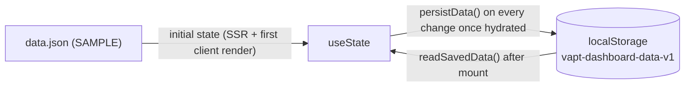

# State and persistence

The console state lives in one React store: `DashboardProvider` in `lib/store.tsx`. Components read it with `useDashboard()` and change it **only** through `actions`.

<Source path="lib/store.tsx" />

```tsx
"use client"
import { useDashboard } from "@/lib/store"

export function RetestButton({ findingId }: { findingId: string }) {
  const { findings, actions } = useDashboard()
  const finding = findings.find((f) => f.id === findingId)
  if (finding?.status !== "In Fix") return null
  return <Button onClick={() => actions.requestRetest(findingId, mailto)}>Request retest</Button>
}
```

`useDashboard()` throws if it is called outside `<DashboardProvider>`. Every `/dashboard/*` route already has the provider, through `ConsoleShell`.

## What the hook returns

| Key | Type | Notes |
| --- | --- | --- |
| `data` | `DashboardData` | The raw state, including `config`, `events`, `history` and `reports` |
| `hydrated` | `boolean` | `false` until saved data has loaded after mount |
| `products` | `Product[]` | In `PRODUCT_ORDER`, with an `id` added |
| `findings` | `Finding[]` | Sorted by severity, then newest `found` |
| `actions` | object | The only way to change state (see below) |

`products` and `findings` are memoised from `data`. Metrics are **not** stored. Call `metricsFor(product, findings)` where you need them.

## Actions

| Action | Signature | Effect |
| --- | --- | --- |
| `inviteUser` | `(values) → boolean` | Owner only. Adds an Invited user and refuses duplicate emails. Logs Access |
| `updateUser` | `(id, patch) → boolean` | Owner only. Changes name, email, role or status, guarded by `accessChangeError`. Logs Access |
| `removeUser` | `(id) → boolean` | Owner only. You can't remove yourself or the last active Owner. Logs Access |
| `updateArea` | `(productId, index, status)` | Changes an area status, with the Tested/Blocked guards. Stamps `startedAt`/`testedAt`/`lastTested` and logs Progress or Blocker |
| `updateAreaField` | `(productId, index, field, value)` | Edits method, result, notes, reason or dates. Logs nothing |
| `updateProduct` | `(productId, field, value)` | Edits a register field. A status change needs `switchReason` and the close-out criteria, and logs Switch |
| `updateCycleDate` | `(productId, cycleKey, isoDate)` | Records a cycle completion in `done`. Logs Progress |
| `updateFinding` | `(findingId, status, reason?)` | Status transition with stamps. See the [finding lifecycle](/concepts/finding-lifecycle) |
| `addFinding` | `(productId, values) → id` | Creates a Triaged finding. Escalates, reopens and snapshots as needed |
| `requestRetest` | `(findingId, mailto)` | In Fix → Ready for Retest, then opens the mail draft |
| `saveEmail` | `(email)` | Stores the tester address in `config.retestEmail` |
| `saveReport` | `(report)` | Archives a report. Weekly reports add a snapshot, and a passing close-out report stamps the close-out date |
| `downloadFinding` | `(findingId)` | Downloads the SOP-formatted finding as Markdown |
| `exportData` | `()` | Downloads the full state as `vapt-dashboard-data.json` |
| `resetData` | `()` | Clears `localStorage` and restores the bundled sample |

Actions show their own toasts, both for success and for refusals. Callers don't need to.

## Persistence



- **Key:** `vapt-dashboard-data-v1`. Bump the suffix if you make a change to `DashboardData` that old saved data can't satisfy.
- **Merge on load:** saved data is spread over `SAMPLE`, and `config` is merged key by key. `events`, `history` and `reports` fall back to empty arrays. Data without `products` or `findings` objects is rejected, and the sample is used.
- **Failures are non-fatal.** A failed read or write (private mode, quota, blocked storage) is logged to the console, and the app keeps running in memory.
- **No write before hydration.** The persist effect is skipped until saved data has loaded, so the sample never overwrites a user's saved state.

:::warning[localStorage is not shared storage]
Edits stay in one browser on one device, and nothing is written back to `data.json` or Jira. Don't build features that assume another user can see a change.
:::

## Writing a new action

The pattern is: **validate against current `data`, refuse with a toast, then make one functional `setData` that changes the record and adds an event.** See [Add a store action](/guides/add-a-store-action) for a worked example.
