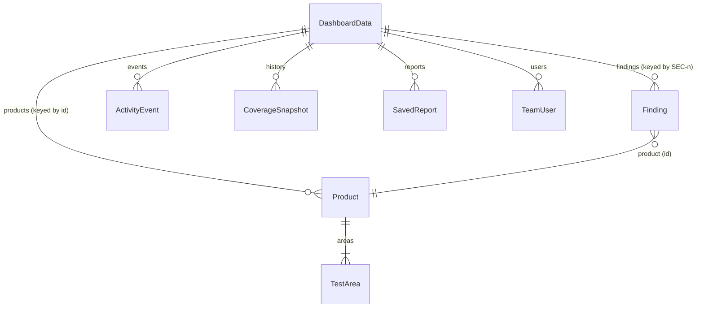

# Domain model

All domain types are in `lib/types.ts`. The whole application state is one `DashboardData` object, and the store keeps it in memory and in `localStorage`.

<Source path="lib/types.ts" />



## Records vs. entities

The stored form and the in-memory form differ in one way. Records are stored **keyed by id**, without an `id` field, and the store adds the `id` when it reads them:

```ts
interface ProductRecord { name: string; tier: Tier; areas: TestArea[] /* … */ }
interface Product extends ProductRecord { id: string }   // e.g. "reminterns"

interface FindingRecord { product: string; severity: Severity /* … */ }
interface Finding extends FindingRecord { id: string }   // e.g. "SEC-151"
```

`useDashboard()` gives components `products: Product[]` and `findings: Finding[]`. Products come back in `PRODUCT_ORDER`, with unknown ids last. Findings are sorted by severity, then newest first.

## Product

A product is one application under test, assigned to a risk **tier** (1 = highest risk).

| Field | Type | Meaning |
| --- | --- | --- |
| `name` | `string` | Display name |
| `tier` | `1 \| 2 \| 3` | Risk tier. Drives cycle frequency and the risk-score multiplier |
| `status` | `ProductStatus` | `Not started` · `In progress` · `Paused` · `Baseline complete` · `Continuous` |
| `areas` | `TestArea[]` | The test areas that make up the baseline |
| `baselineStart` | ISO date | Start of the baseline test |
| `estDays` | `number` | Planned working days, used for plan-vs-actual (default 7) |
| `closeout` | ISO date | Recorded baseline close-out date |
| `lastTested` | ISO date | Last time an area was marked Tested. Used for the stall check |
| `resumeOn` | ISO date | When a paused product should resume |
| `switchReason` | `string` | The Manager-approved reason or handover text. **Required before any status change** |
| `done` | `Record<cycleKey, ISO date>` | Last completion date for each test cycle (`baseline`, `regression`, `auth`…) |
| `owner`, `domain`, `jiraEpic`, `technology`, `dataSensitivity` | `string` | Register fields |

## Test area

Test areas use **short keys** because they are stored many times over. Learn these four:

| Key | Meaning | Values |
| --- | --- | --- |
| `n` | Area name | e.g. `"Authentication"` |
| `hr` | High-risk (priority) area | `boolean`. Priority coverage counts only these |
| `s` | Status | <Badge tone="neutral">To Do</Badge> <Badge tone="primary">In Testing</Badge> <Badge tone="critical">Blocked</Badge> <Badge tone="success">Tested</Badge> |
| `j` | Jira task key | optional |

The longer fields are `method`, `result` (`"No finding"` or `"Finding raised"`), `notes`, `reason` (a blocker reason or an untested reason), `startedAt` and `testedAt`.

## Finding

A finding is one validated vulnerability. It mirrors a Jira ticket in project `SEC`.

| Group | Fields |
| --- | --- |
| Identity | `id` (`SEC-n`), `product`, `title` (formatted `[Product][Feature][Severity] Title`) |
| Classification | `severity`, `cvss`, `reference` (CWE/OWASP), `affectedFeature` |
| SOP report body | `description`, `steps`, `impact`, `evidence` (redacted), `environment`, `recommendation`, `foundWhile`, `relatedTask` |
| Lifecycle dates | `found`, `validatedAt`, `reportedAt`, `due`, `readyDate`, `retestDue`, `retestRequestedAt`, `retestCompleted`, `closed` |
| Exit | `status`, `statusReason` (required for Rejected, Risk Accepted, Won't Fix) |
| Late finding | `late`, `previousTest`, `discoveryMethod`, `lateCause` (all three required when `late`) |
| Escalation | `exploitationSuspected`. Logs an Incident event |

A finding counts as **complete** (`isFindingComplete`) when every SOP report field is filled in, the late-finding fields are filled in if it is late, and there is a reason if it is in an exit status. The baseline can't close while any finding is incomplete.

## Activity event

```ts
interface ActivityEvent { date: string; type: EventType | string; product?: string; text: string }
```

The types are `Progress`, `Finding`, `Escalation`, `Retest`, `Report`, `Switch`, `Close-out`, `Blocker`, `Incident` and `Access`. Store actions add new events at the front of `events`, so the array is newest first. Events are the audit trail. Never edit or remove them in place.

## Coverage snapshot and saved report

- `CoverageSnapshot { date, cov: Record<productId, percent> }` records weekly history. The store adds one when a weekly report is saved, and the Python build adds one with `--snapshot`.
- `SavedReport { id, type, date, title, body }` is a generated Markdown report (`daily` · `weekly` · `monthly` · `closeout`) archived in the browser.

## Team users and roles

:::note[New and still being built]
User management arrived with `lib/users.ts`. Roles describe what each person is *meant* to do under the SOP. At the moment only user management itself is enforced, and only through the Owner check.
:::

```ts
type Role = "Owner" | "Manager" | "Security Tester" | "Developer"
interface TeamUser { id: string; name: string; email: string; role: Role; status: "Active" | "Invited" | "Suspended"; invitedAt: string; lastActiveAt?: string }
```

`data.users` is optional. When it is absent, the store uses `SAMPLE_USERS`. There is no identity provider yet, so the current user is the seeded Owner, `CURRENT_USER_ID`. `PERMISSIONS` in `lib/users.ts` is the role matrix shown to Owners. `accessChangeError()` enforces two invariants:

- You can't suspend or remove your own account.
- There must always be at least one **active Owner**.

Every access change logs an `Access` event.

## Config

`config: { base?, project?, retestEmail? }` holds the Jira base URL, the project key (default `SEC`, used by `nextFindingId`) and the tester address used for retest emails.
