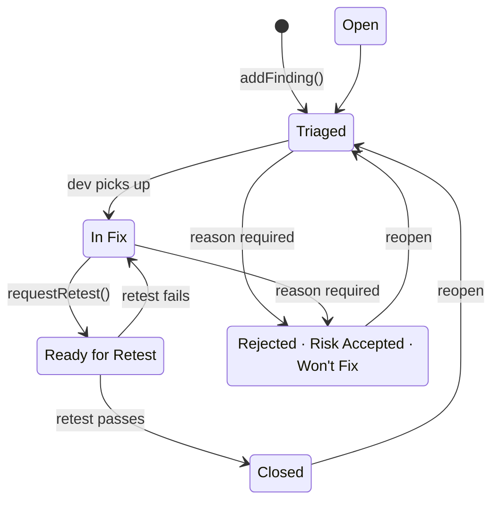

# Finding lifecycle

A finding is created **Triaged**: the tester has already validated it when they raise it. It then moves through fix and retest until it is closed, or it leaves through one of three exit statuses, each of which needs a reason.

The status control allows any transition, because real work isn't strictly linear. The data guard is that an exit status needs a reason. **Open** is mainly an import status: the Python build maps unrecognised Jira statuses to it.

## Status groups

| Group | Statuses | Constant |
| --- | --- | --- |
| Active | <Badge>Open</Badge> <Badge>Triaged</Badge> <Badge>In Fix</Badge> <Badge>Ready for Retest</Badge> | `ACTIVE_FINDING_STATUSES` |
| Closed | <Badge>Closed</Badge> plus the exit statuses | `CLOSED_STATUSES` |
| Exit (reason required) | <Badge>Rejected</Badge> <Badge>Risk Accepted</Badge> <Badge>Won't Fix</Badge> | `EXIT_STATUSES` |

`isClosed(finding)` checks membership of `CLOSED_STATUSES`. Open counts, risk scores and overdue checks all use active findings only.

## What each transition writes

| Moving to | Fields stamped by `updateFinding` | Event type |
| --- | --- | --- |
| Ready for Retest | `readyDate = today`, `retestDue = today + 2 working days`, `retestRequestedAt = today` | `Retest` |
| Closed | `closed = today`, and `retestCompleted = today` if it came from Ready for Retest | `Finding` |
| An exit status | `statusReason` (trimmed, required) | `Finding` |
| Open / Triaged / In Fix | clears `closed` and `statusReason` (a reopen) | `Finding` |

Every transition adds an event of the form `SEC-123 status changed from In Fix to Ready for Retest`, with the reason if one was given.

## Creating a finding

`addFinding(productId, values)` does the following, in order:

1. Allocates the next id with `nextFindingId` (highest `SEC-n` + 1).
2. Formats the title as `[Product][Feature][Severity] Title`.
3. Stamps `found`, `validatedAt` and `reportedAt`, and works out `due` from the [fix deadline](/concepts/sop-rules#fix-deadlines).
4. **If it is a late finding**, reopens the affected area (back to In Testing, with the discovery method added to its methods and a note about the cause).
5. Logs a `Finding` event, plus `Progress` for a reopen, `Escalation` for Critical or High, and `Incident` when `exploitationSuspected` is set.
6. Records a coverage snapshot for today, because a reopen can change coverage.

## Requesting a retest

`requestRetest(findingId, mailto)` only acts on findings that are **In Fix**. It moves the finding to Ready for Retest with the same stamps as above and logs the request. If a tester email is configured in Settings, it also opens a prefilled `mailto:` draft built by `retestMailto()`. Nothing is sent automatically.
