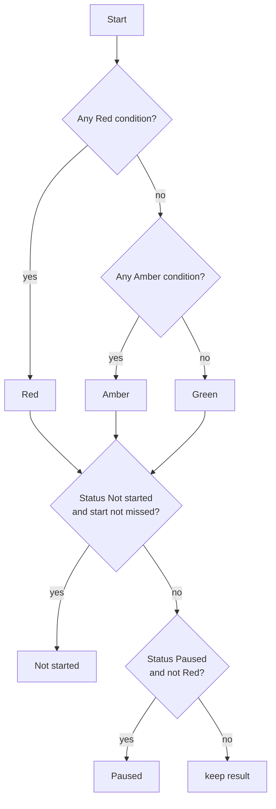

# Product health

Health is **derived, never stored**. `metricsFor(product, findings)` recomputes it on every render from the product's dates and its findings, so it cannot go stale.

<Source path="lib/metrics.ts" />

## The states

| Health | Means |
| --- | --- |
| <Badge dot>Red</Badge> | An SOP commitment is already broken |
| <Badge dot>Amber</Badge> | Something is slipping and needs attention this week |
| <Badge dot>Green</Badge> | On plan |
| <Badge dot>Paused</Badge> | Deliberately paused (unless something has already turned Red) |
| <Badge dot>Not started</Badge> | Baseline not started, and its start date has not passed |

Health is always shown as a dot **and** a word, never by colour alone.

## Decision order

The checks run in this order. The first state that matches wins, and then two overrides apply.



### Red conditions

| Flag | Condition |
| --- | --- |
| `overdueCritical` | an open Critical finding has `due` before today |
| `behind > 20` | an In progress product is more than 20 points behind plan |
| `overdueCycle` | any non-event test cycle has a *next due* date before today |
| missed baseline | In progress, the planned end date has passed, and coverage is below 80% |
| `missedStart` | Not started, and `baselineStart` is in the past |
| `missedResume` | Paused, and `resumeOn` is in the past |

### Amber conditions

| Flag | Condition |
| --- | --- |
| `overdueHigh` | an open High finding is past `due` |
| `overdueRetest` | a Ready for Retest finding is past `retestDue` |
| `behind > 0` | an In progress product is behind plan by 1 to 20 points |
| paused | status is Paused |
| `stalled` | In progress, and nothing has been marked Tested for 3 or more working days |

## Plan vs. actual

For an **In progress** product, the planned coverage is a straight line over `estDays` working days, starting at `baselineStart`:

```text
elapsed = working days from baselineStart to today (the start day counts if it is a working day)
planned = min(100, round(elapsed ÷ estDays × 100))
behind  = max(0, planned − coverage)
endDate = baselineStart + estDays working days
```

For any other status, `planned` equals `coverage` and `behind` is 0.

:::note[Dates are local ISO strings]
All dates are `YYYY-MM-DD` strings compared lexically, and `todayIso()` uses the browser's local timezone. Use the helpers in `lib/dates.ts` and don't construct `Date` objects in components. `new Date("2026-11-14")` parses as UTC midnight and can shift the day.
:::
