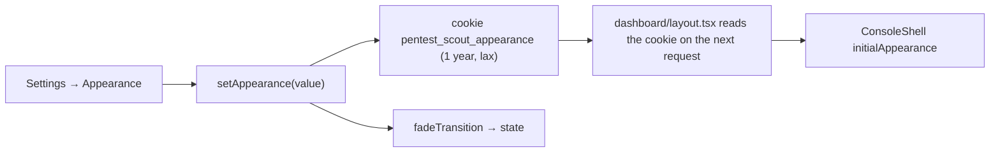

# Theming

Light and dark are both first-class and defined token for token. A separate **appearance** setting changes only the sidebar.

## Light and dark

`next-themes` toggles a `.dark` class on `<html>`. Tailwind's dark variant is bound to it:

```css title="app/globals.css"
@custom-variant dark (&:is(.dark *));
```

Every token is defined once in `:root` and again in `.dark`. **Don't write raw colours in components.** Use the tokens (`bg-card`, `text-muted-foreground`, `bg-critical/12`), and dark mode comes with them.

### Theme reveal

`switchTheme(next, setTheme, origin?)` in `lib/theme-transition.ts` reveals the new theme with a circle that grows from the toggle button. It uses the View Transitions API, runs for 560ms and uses the expo ease. The **`D`** key does the same, except while the user is typing in a field. The switch is instant when View Transitions are unavailable or reduced motion is on.

## Appearance: default vs. dark sidebar

| Appearance | Shell |
| --- | --- |
| `default` | Light sidebar on the neutral paper ground |
| `dark-sidebar` | Dark navigation frame on `--sidebar-contrast`, with light content inset. The sidebar subtree takes the full `.dark` token set |



The choice is stored in a cookie, **not** `localStorage`, so the server renders the right shell on the first paint with no flash. Read it in components with `useAppearance()` (`components/appearance.tsx`).

## These docs

This site reuses Pentest Scout's tokens in `docs/src/css/custom.css`: the same oklch values, Figtree and Geist Mono, pill controls, ring-first cards, and tinted callouts. When you change a token in `app/globals.css`, change it here too so the docs and the console stay consistent.
