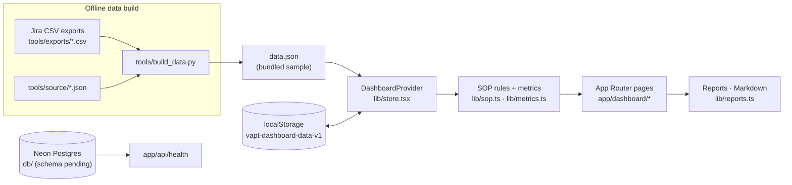

# Pentest Scout developer docs

Pentest Scout is the in-house console for application-security testing. It tracks every product against the **Application Security Testing SOP v1.0**: which test areas are covered, which findings are open and when they are due, how fast retests come back, and the reports the SOP asks for. These pages explain how it is built and how to change it without breaking those rules.

:::warning[Sample data only]
Everything shipped in this repository, including `data.json`, the CSV exports and the products named in these docs, is **sample data**. Never put credentials, customer data or unredacted evidence into the repo, the docs, or the browser store.
:::

## What the console does

Three kinds of people use Pentest Scout, and the code is organised around their jobs:

| Who | What they do in Pentest Scout | Where it lives in code |
| --- | --- | --- |
| **Security Tester** (primary) | Marks test areas, records method and result, raises SOP-formatted findings, turns retests around | `components/products/`, `components/findings/`, `lib/store.tsx` |
| **Manager** | Reads health and plan-vs-actual, approves status switches, reads daily / weekly / monthly / close-out reports | `lib/metrics.ts`, `lib/reports.ts`, `app/dashboard/reports/` |
| **Developers / dev leads** | Move findings to In Fix and request retests | `components/findings/finding-status-control.tsx` |

The workflow rules are the SOP itself, not generic issue tracking. Coverage is computed against the SOP close-out line, and the console refuses an action when the SOP would. For example, it will not mark an area Tested without a method and a result.

<CloseoutMeter tested={17} inTesting={3} blocked={1} todo={4} label="Sample product coverage" />

The meter above is the console's signature element. The tick marks the SOP's **80% close-out line**, and the rule behind it is explained in [SOP rules](/concepts/sop-rules).

## Architecture at a glance

- **Next.js 16 App Router** with React 19, TypeScript, Tailwind CSS v4 and shadcn/ui (Luma style).
- **Client-side store.** Every state change goes through the actions in `lib/store.tsx`. Data starts from the bundled `data.json` and persists per browser in `localStorage`.
- **Pure rule modules.** `lib/sop.ts` holds the SOP constants and `lib/metrics.ts` derives coverage, risk and health from them. Neither touches React.
- **A database layer is being introduced.** Drizzle ORM and Neon Postgres are wired up (`db/`, `/api/health`), but the schema is still empty, so no feature reads from it yet.
- **Security headers on every page** come from `proxy.ts`: a per-request CSP nonce, no framing, no referrer, `no-store`.

## Where to start

- **New to the repo?** Start with [Setup](/getting-started/setup), then the [project structure](/getting-started/project-structure).
- **Changing a rule** (a deadline, a cycle, a health threshold)? Read [SOP rules](/concepts/sop-rules), then follow [your first change](/getting-started/first-change).
- **Adding UI?** Read the [design system](/design-system/foundations) before you write a component.
- **Looking up a function?** Go to the [`lib/` API reference](/reference/lib).

:::info[This is not the Next.js you know]
The app runs Next.js 16, which renames and changes several APIs. For example, `middleware.ts` is now `proxy.ts`, and request APIs such as `cookies()` and `headers()` are async. Before you write framework code, read the guide that ships at `node_modules/next/dist/docs/`.
:::
