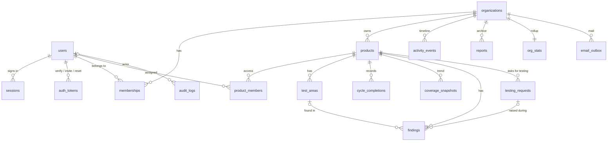

# Database architecture

Status: **v2, built and live (2026-11-14).** Neon runs this schema, and the app connects as `vapt_app` (a member of `app_user`), so row-level security is enforced. What was built in each phase, and where it differs from the plan: [integration-plan.md § As built](integration-plan.md#as-built-p2p9). The build order is in [integration-plan.md](integration-plan.md).

Pentest Scout is a multi-company product. Companies sign themselves up, a Pentest Scout admin approves them, and each company then tracks VAPT work on its own products with its own team. A company can also ask Pentest Scout to do the testing for one of its products.

**Fixed decisions**
1. **Self-serve sign-up only.** Super Admins never create companies.
2. **Every company needs Super Admin approval** before it can use the console.
3. **Testing:** a company's own testers test. A company without testers sends a *testing request*, and Super Admins do the testing inside that company.
4. **Access:** Super Admins can read and change everything in every company, and every such action is audited and visible to that company. Inside a company, the Owner decides who can edit what.
5. **Email is built but not sending.** Every email is queued in an outbox. Its link works, and an admin can copy it until a provider is connected.
6. **The SOP's rules stay in code** (`lib/sop.ts`): severity deadlines, cycle rules and the 80% close-out line. The database stores facts, and code derives health, coverage and due dates.

---

## 1. Shape

There is one Postgres database. Every company-owned row carries `org_id`, and three layers keep companies apart (section 6).

| Group | Tables | Scope |
|---|---|---|
| **Identity** | `users`, `sessions`, `auth_tokens` | Platform-wide. A person is one row, whatever companies they belong to. |
| **Tenancy** | `organizations`, `memberships`, `product_members` | Who belongs to which company, with what role and which product access |
| **VAPT domain** | `products`, `test_areas`, `cycle_completions`, `coverage_snapshots`, `findings`, `activity_events`, `reports`, `testing_requests` | One company each (`org_id`) |
| **Platform** | `email_outbox`, `org_stats` | Run by the platform. Readable by Super Admins. |
| **Audit** | `audit_logs` | Rows are only ever added. `org_id` is null for platform-level actions. |



---

## 2. Identity

### `users`
| Column | Type | Notes |
|---|---|---|
| `id` | uuid PK | |
| `email` | text UK | Lower-cased (a check enforces it) |
| `name` | text | |
| `password_hash` | text | scrypt `scrypt$15$8$3$salt$hash`. Null only while `invited` (someone invited by email who hasn't chosen a password yet); a check requires it for `active`. |
| `platform_role` | `platform_role` enum, nullable | `SUPER_ADMIN`, or null for everyone else. More than one Super Admin is allowed. |
| `status` | `user_status` | `invited` (no password yet), `active`, or `disabled` (a platform-level block) |
| `email_verified_at` | timestamptz | Null until the verify link is used. Needed before a company can be submitted for review. |
| `last_login_at`, `password_changed_at`, `created_at`, `updated_at` | timestamptz | |

- **Users have no company role.** Roles live on `memberships`.
- Users are never deleted, so their names stay on findings and audit rows.
- Super Admins are created only by `pnpm user:create`. The app can't grant or remove `platform_role`. The trigger `users_protect_platform_role` refuses changes to it from any session except the CLI's, which sets `app.cli = on`.
- Password rules stay as they are (`lib/auth/password-rules.ts`): 12–128 characters, and the password can't contain the email name.

### `sessions`
Unchanged from v1. A random cookie value whose SHA-256 is stored, 12 hours idle and 7 days at most. It is re-checked on every request and can be revoked. A session belongs to a person, not a company: the company comes from the URL (section 6).

### `auth_tokens`
One-time links. Only the hash is stored, each link works once, and making a new link cancels the earlier unused one for the same purpose.

| Purpose | Created by | Extra columns | Expiry | Link |
|---|---|---|---|---|
| `email_verify` | Sign-up, or "Resend" | – | 24 h | `/verify/[token]` |
| `org_invite` | An Owner, or a Manager for testers and developers | `org_id` (the role is on the `invited` membership row) | 72 h | `/set-password/[token]` for a new person, `/invite/[token]` for an existing account |
| `password_reset` | "Forgot password", an Owner, or a Super Admin | – | 24 h | `/set-password/[token]` |

---

## 3. Tenancy

### `organizations`
| Column | Type | Notes |
|---|---|---|
| `id` | uuid PK | |
| `name` | text | |
| `slug` | text UK | URL key: `/o/acme`. Lower-case and URL-safe. Reserved words (`admin`, `api`, `new`…) are refused. |
| `status` | `org_status` | See the lifecycle below |
| `industry`, `size`, `website` | text | Collected at onboarding for review |
| `submitted_at`, `reviewed_at` | timestamptz | |
| `reviewed_by` | uuid → users | |
| `review_note` | text | Required for `rejected` and for "changes requested" |
| `finding_prefix` | text | Default comes from the slug, e.g. `ACME`. Editable until the first finding exists. |
| `next_finding_no` | int | Per-company counter: `UPDATE … SET next_finding_no = next_finding_no + 1 RETURNING` |
| `settings` | jsonb | Retest email, Jira base URL. Typed in code. |
| `created_by`, `created_at`, `updated_at` | | |

**Lifecycle**
```
draft ──submit──► pending_review ──approve──► active ⇄ suspended
  ▲                  │      │                   │
  └──request changes─┘      └──reject──► rejected ──edit & resubmit──► pending_review
                                                    active/suspended ──close──► closed
```
| Status | Who can do what |
|---|---|
| `draft` | The Owner edits the company and products in `/onboarding` |
| `pending_review` | The same, plus an "Under review" page. No team, findings or testing requests. |
| `rejected` | The Owner sees `review_note` and can edit and resubmit |
| `active` | The full console |
| `suspended` | Locked for members; data is kept. Super Admins have full access. |
| `closed` | Locked. Data is kept until a deletion job runs (later). |

Each status change writes an audit row and queues an email to the Owner (`org.approved`, `org.rejected`, `org.changes_requested`).

### `memberships`
| Column | Type | Notes |
|---|---|---|
| `org_id`, `user_id` | PK | |
| `role` | `org_role` | `OWNER`, `MANAGER`, `SECURITY_TESTER`, `DEVELOPER` |
| `status` | `membership_status` | `invited`, `active`, `suspended`, `removed` |
| `invited_by`, `joined_at`, `created_at`, `updated_at` | | |

- A company always has at least one active Owner. The trigger `memberships_keep_an_owner` refuses to demote, suspend or remove the last one.
- Suspending or removing a member revokes their sessions only if they have no other active membership. Otherwise the next request in that company simply fails membership.

### `product_members`
| Column | Type | Notes |
|---|---|---|
| `org_id`, `product_id`, `user_id` | PK `(product_id, user_id)` | Composite FKs to `products(org_id, id)` and `memberships(org_id, user_id)` |
| `access` | `product_access` | `view` or `edit` |
| `added_by`, `added_at` | | |

Owners don't need rows here: they see and edit every product in their company.

---

## 4. Roles and permissions

Two layers decide access, both in `lib/auth/roles.ts`:
1. **Role:** *what kind* of thing someone can do. It's fixed and reviewed in code.
2. **Product access:** *which* products someone works on, and whether they can only `view` or can `edit`. The Owner sets it.

**Platform:** `SUPER_ADMIN` passes every check in every company, plus the `/admin` area. Every write records `actor_platform = true`, and the company's audit log shows it as "Pentest Scout admin".

| Permission | Owner | Manager | Security Tester | Developer |
|---|:-:|:-:|:-:|:-:|
| `org.manage`: company profile, prefix, settings, submit for review | ✓ | – | – | – |
| `org.audit`: read the company audit log | ✓ | – | – | – |
| `product.create` / `product.archive` | ✓ | – | – | – |
| `testing.request` | ✓ | – | – | – |
| `member.invite` / `member.manage` | any role | testers and devs | – | – |
| `member.assign`: set product access | ✓ | testers and devs, on products they can edit | – | – |
| `product.read` | all | view or edit | view or edit | view or edit |
| `product.edit`: details, tier, status, cycles | all | edit | – | – |
| `area.update` | all | edit | edit | – |
| `finding.read` (including steps and evidence) | all | view or edit | view or edit | view or edit |
| `finding.create` / `finding.edit` | all | edit | edit | – |
| `finding.transition` | all | edit | edit | edit, devs' moves only |
| `report.generate` / `report.read` | ✓ | ✓ (their products) | ✓ (their products) | – |
| `activity.write` | ✓ | edit | edit | – |

Allowed finding status changes stay a list of `(from, to, roles)` (`FINDING_TRANSITIONS`). Exits (Rejected, Risk Accepted, Won't Fix) need Owner or Manager plus a reason. A refused change is audited as `denied`.

The client gets `{ user, org: { id, slug, name, status }, role, products: { [productId]: "view" | "edit" }, platform }` for hiding UI only. The server checks again every time.

---

## 5. VAPT domain

Every table has `org_id uuid not null`. Child tables reference their parent with a composite key `(org_id, parent_id) → parent(org_id, id)`, so a row can never point into another company.

- **`products`**: `(org_id, slug)` unique, `tier` between 1 and 3, `status`, `owner_name` text, `archived_at`, plus the v1 columns (domain, technology, data sensitivity, Jira epic, baseline start, estimated days, close-out, last tested, resume on, switch reason).
- **`test_areas`**: `(product_id, name)` unique, `position`, `status`. A `blocked_reason` is required when Blocked, and `result` is null when empty. A tier template fills the first set of areas when a product is created.
- **`cycle_completions`**: PK `(product_id, cycle_key, completed_on)`, plus `completed_by`. "Latest per cycle" is a query.
- **`coverage_snapshots`**: PK `(product_id, taken_on)`, `coverage_pct` from 0 to 100. Written by the daily job and by changes to areas.
- **`findings`**: `key` is unique per `(org_id, key)`, e.g. `ACME-42`, built from `finding_prefix` and `next_finding_no` in the same transaction. Columns as in v1, plus `testing_request_id` (nullable) and `assignee_id`. The server computes `due_on` and `retest_due_on`, never the client. A check requires `status_reason` for the exit statuses. Indexes: `(org_id, status, due_on)`, `(product_id, status)`.
- **`activity_events`**: the type enum includes `Access`. Written by the server in the same transaction as the change it describes. `author_id` and `author_platform` record who wrote it.
- **`reports`**: plus `product_id` (nullable; set for close-out reports). A close-out report updates its product by ID, not by matching the product name in the text.
- **`testing_requests`**:

| Column | Notes |
|---|---|
| `org_id`, `product_id` | Composite FK |
| `requested_by` | An Owner |
| `scope`, `environment`, `notes`, `contact` | text |
| `preferred_start`, `preferred_end`, `scheduled_start`, `scheduled_end` | date |
| `status` | `submitted → accepted → scheduled → in_progress → completed`; also `declined` (from submitted) and `cancelled` (Owner, before `in_progress`) |
| `decision_note` | Required for `declined` |
| `assigned_to` | A Super Admin |
| `completed_at`, `created_at`, `updated_at` | |

  Findings raised by a Super Admin while a request for that product is `in_progress` get its `testing_request_id`, and the UI labels them "Raised by Pentest Scout".

**Conventions:** UUID IDs, `timestamptz` in UTC, `date` for SOP calendar days, snake_case columns, Postgres enums for fixed lists, `created_at` and `updated_at` on editable tables, no soft-delete columns except `products.archived_at`.

---

## 6. Keeping companies apart

Three independent layers. Any one of them alone would stop a cross-company read.

1. **Request context.** Each page and action under `/o/[org]` calls `getContext(orgSlug)`: session → user → active membership in that company (or Super Admin) → `{ user, org, role, products, platform }`. A missing membership returns **404**, not 403, so it never confirms that a company exists. All data access goes through `server/*` functions that take `ctx`. Nothing reads `org_id` from the browser.
2. **Composite foreign keys** (section 5). The database refuses mismatched `org_id`s.
3. **Row-level security.** `withScope` and `withOrg(ctx, fn)` open a transaction and run `set_config` for `app.org_id`, `app.user_id` and `app.platform`. `withSystem` is for token flows and cron jobs, and `adminRead` is for the admin area. `active_memberships_elsewhere()` is a `SECURITY DEFINER` count, because a person's other companies can't be seen from inside one company. A policy on each company table allows a row only when `org_id = current_setting('app.org_id')::uuid` or platform is on. The policies are created with the schema and bind because the app connects as `vapt_app`, a login role in `app_user`, which isn't the table owner. Migrations and scripts use `MIGRATION_DATABASE_URL`, which connects as the owner.

**Routes**
| Area | Paths | Gate |
|---|---|---|
| Public | `/signup`, `/login`, `/verify/[token]`, `/invite/[token]`, `/set-password/[token]`, `/forgot-password` | None. Rate-limited. |
| Onboarding | `/onboarding/**` | Signed in, plus a company in `draft`, `pending_review` or `rejected` |
| Company console | `/o/[org]/**` | `getContext`, plus the company is `active` (or the user is a Super Admin) |
| Admin | `/admin/**` | `platform_role = SUPER_ADMIN` |
| Old route | `/dashboard/**` | Redirects to `/o/<last used company>` or `/admin` |

`proxy.ts` only checks that a session cookie exists. Every real check runs on the server against the database.

---

## 7. Email

`sendEmail({ to, template, data, orgId?, userId? })` in `lib/email/` renders the template and inserts a row into `email_outbox`. **No code sends mail directly.**

**`email_outbox`**: `id`, `to_email`, `template`, `subject`, `body_text`, `body_html`, `link`, `token_id` (the one-time token inside `link`), `org_id`, `user_id`, `status` (`pending`, `sent`, `failed`, `cancelled`), `attempts`, `last_error`, `created_at`, `sent_at`, `expires_at`.

| `EMAIL_TRANSPORT` | Behaviour |
|---|---|
| `log` (development) | Queues the email, prints it to the server console, and shows the link on the "Check your email" screen |
| `outbox` (production now) | Queues the email only. **Admin → Outbox** lists pending emails with "Copy link". |
| `<provider>` (later) | A cron job sends pending rows with retries. The only new code is a transport file. |

Templates: `verify_email`, `org_invite`, `password_reset`, `org_submitted` (to Super Admins), `org_approved`, `org_rejected`, `org_changes_requested`, and `testing_request_*`.

The `link` and body columns hold a live token, so they are blanked when the email is sent or its token expires. Only Super Admins can read the outbox. Invite and reset dialogs still show the copy link to the person who created it.

---

## 8. Audit log

Same guarantees as v1:
- The row is written in the same transaction as the change.
- Rows can only be added: a trigger refuses `UPDATE`, `DELETE` and `TRUNCATE`.
- Secret-looking fields are removed before insert.
- Sign-in attempts store an HMAC of the email, never the address.
- Sign-in throttling counts recent failures from this table.

v2 changes:
- `org_id` (nullable) and `actor_platform` boolean. `actor_role` becomes text, holding the org role or `SUPER_ADMIN` at the time.
- **Readers:** Super Admins see everything. An Owner sees rows where `org_id` is their company, including Super Admin actions in it.
- **New actions:** `signup.*`, `email.verified`, `org.created`, `org.submitted`, `org.approved`, `org.rejected`, `org.changes_requested`, `org.suspended`, `member.*`, `product_access.changed`, `testing_request.*`, `admin.entered_org`.
- Indexes: `(org_id, occurred_at desc)` is added to v1's.

---

## 9. Super Admin area and scale

**Admin navigation:** Overview · Approvals · Companies · Testing requests · Sign-ups · Products · Users · Outbox · Audit log · Settings.

**Sign-up funnel.** No extra table; every stage is derived:
| Stage | Query |
|---|---|
| Signed up, not verified | `users.email_verified_at is null` and no `platform_role` |
| Verified, no company | No membership row |
| Draft | `organizations.status = 'draft'` |
| Waiting for review | `status = 'pending_review'`, oldest first |
| Failures | `audit_logs` where `action like 'signup.%'` or `verify.%` with `outcome <> 'success'` |

"Abandoned" means no activity for 7 days in an early stage.

**`org_stats`** has one row per company: `products`, `members`, `open_critical`, `open_high`, `open_total`, `overdue`, `last_activity_at`, `updated_at`. It's refreshed by the transactions that change findings and products, and rebuilt nightly. Admin lists read this table with keyset pagination and never scan domain tables across companies.

**Built for 1,000+ companies**
- Every company query starts with `org_id`, and so does every index.
- Neon pooled connections, with a pool `max` of 5 per instance.
- Background work runs as Vercel Cron (`vercel.json`) calling `/api/cron/daily`, protected by `CRON_SECRET`. It rebuilds `org_stats`, takes daily coverage snapshots, blanks expired email links and prunes old tokens. Planned additions: SLA-reminder and abandoned-sign-up emails, and sending once P10 is done.
- `audit_logs` is split by month once it passes ~50M rows.
- Sign-up abuse protection: per-IP and per-email limits from `audit_logs`, verification before submission, and human approval.

---

## 10. Code layout

```
db/schema/        enums · identity · tenancy · vapt · platform · audit
db/migrations/    0000_v2.sql (generated) · 0001_guards.sql (triggers, RLS policies, app_user grants)
lib/auth/         roles.ts (matrix + product access) · session.ts · password*.ts · tokens.ts · audit.ts
lib/email/        send.ts · templates/*.ts · transports/{log,outbox}.ts
server/           context.ts (getContext, withOrg) · orgs.ts · members.ts · products.ts · findings.ts
                  areas.ts · reports.ts · activity.ts · testing.ts · admin.ts · signup.ts
app/(public)/     signup · login · verify · invite · set-password · forgot-password
app/onboarding/   company · products · review
app/o/[org]/      overview · products · findings · reports · activity · testing · team · settings
app/admin/        overview · approvals · companies · testing · signups · products · users · outbox · audit · settings
app/api/cron/     jobs
scripts/          create-user.mjs (Super Admin) · seed.mjs (dev company from data.json)
```

Every function in `server/*` follows the same pattern: `ctx` → permission check → `withOrg` transaction → change → audit row (+ activity event, + `org_stats` update) → return a cut-down record.

---

## Deferred
- An email provider (transport only; see section 7)
- Evidence file uploads
- Two-factor sign-in, which will be required for Super Admins when built
- Billing and plans
- SSO
- A data deletion job for `closed` companies
- Tamper-evident audit hash chain
