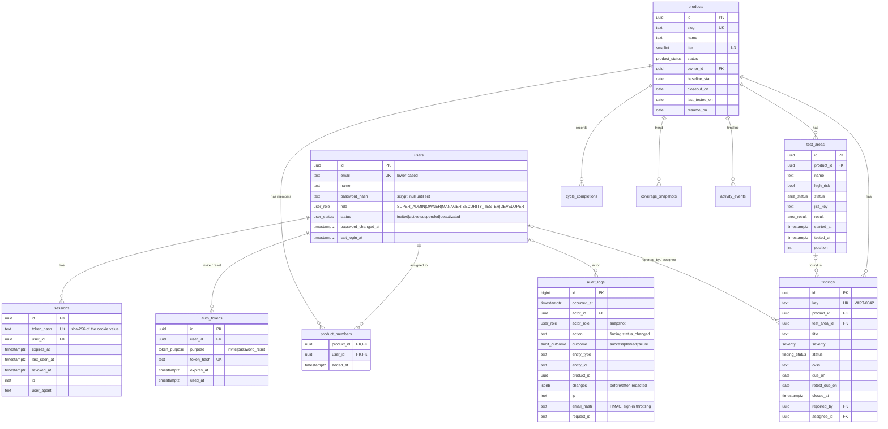

# Database architecture

Status: **live.** Migrations are applied to the Neon database (13 tables, no rows yet). The schema is in `db/schema/`, the migrations in `db/migrations/`. Sign-in, sessions, users and the audit log run on it. Products, findings and reports still use the browser's local data; moving them here is the next step.

**Assumptions** (say if any are wrong):
- **One organisation.** `SUPER_ADMIN` is the platform team's single account; the customer's top role is `OWNER`. There is no separate tenant level. Adding organisations later means one `organization_id` column per domain table.
- **The SOP's rules stay in code.** This covers severity deadlines, cycle rules and the 80% close-out line, which live in `lib/sop.ts` today. The database stores facts. Code derives health, coverage and due dates.
- **No public sign-up.** Every account starts as an invitation.

---

## 1. Shape at a glance

There are three groups of tables. Each group has a different reader and a different retention rule.

| Group | Tables | Who reads it | Retention |
|---|---|---|---|
| **Identity and access** | `users`, `sessions`, `auth_tokens`, `product_members` | The auth layer only | Sessions expire; users are deactivated, never deleted |
| **VAPT domain** | `products`, `test_areas`, `cycle_completions`, `findings`, `activity_events`, `coverage_snapshots`, `reports`, `app_settings` | The console, filtered by role and scope | For the life of the product |
| **Audit** | `audit_logs` | Super Admin and Owners | Rows are only ever added. Nothing updates or deletes them, including the app |



---

## 2. Identity and access

### `users`
One row per person.
- **Email:** stored lower-cased (a check enforces it), unique.
- **Password:** an `scrypt` hash from Node's built-in crypto (OWASP profile N=2^15, r=8, p=3), stored as `scrypt$15$8$3$salt$hash` so the cost can be raised later. Rules (`lib/auth/password-rules.ts`): 12–128 characters, not just spaces, and it can't contain the email name.
- **`role`:** one fixed role from a Postgres enum (see section 3).
- **`status`:** `invited` → `active` ⇄ `suspended`, and `deactivated` for removed. **Users are never deleted**, so their name stays on old findings and audit rows. Only `active` users can sign in.
- **Two-factor sign-in is not built yet.** Settings → Security shows it as "Coming soon". When it's built, a migration will add an encrypted secret column, and it will be required for `SUPER_ADMIN`.
- **Invariants:**
  - **Exactly one `SUPER_ADMIN`.** A partial unique index allows at most one. The trigger `users_protect_super_admin` (`0001_guards.sql`) refuses to demote, suspend or delete it, even from a direct SQL session. Nothing in the app can create, edit or assign it; only `pnpm user:create` does.
  - Nobody can change their own role or status. The access layer enforces this.

### `sessions`
Sessions are stored in the database rather than in JWTs, so they can be revoked instantly.
- The browser holds a random 256-bit value in a `__Host-session` cookie (`HttpOnly`, `Secure`, `SameSite=Lax`; plain `session` in development). It contains no ID, role or email.
- The database stores only its SHA-256 hash. A leaked database can't be replayed as live sessions.
- **Every request** re-checks the session: not revoked, not idle-expired, within the absolute limit, and the user still `active`. Role changes apply on the next request.
- **Sessions end when:**
  - the user signs out (that session)
  - the password is set or reset (all sessions)
  - the email changes (all sessions)
  - the account is suspended or removed (all sessions)
- **Lifetime:** 12 idle hours (`last_seen_at` is written at most once every 5 minutes), and 7 days at most.

### `auth_tokens`
One-time links for invites and password resets.
- Only the token's hash is stored. Each link works once (`used_at`) and expires: invites after 72 hours, resets after 24 hours. Making a new link cancels any earlier unused one for that person.
- **Invite flow:** an Owner or Manager invites someone from Users. That creates a user with `status = invited` and shows a one-time link to send them (no email service yet). The invitee opens `/set-password/<token>`, chooses a password, and is signed in as `active`.
- **Reset flow:** an Owner or Manager makes a "Password reset link" for an active user. Same page. Setting the password signs them out everywhere else.
- Inviting someone who was removed before reuses their row, so their history stays linked.

### `product_members`
Scopes which products a user can see.
- **Developers** only see the products they are members of.
- **Security Testers** see every product, but can only change the ones they are assigned to.
- **Super Admin, Owners and Managers** see everything; membership doesn't apply to them.

---

## 3. Roles and permissions

There are five **fixed** roles, highest first:

| Key | Label | Who |
|---|---|---|
| `SUPER_ADMIN` | Super Admin | The platform team. Exactly one account, created with `pnpm user:create`. Hidden from customers' Users list. |
| `OWNER` | Owner | The customer's administrators. |
| `MANAGER` | Manager | Runs the testing programme. |
| `SECURITY_TESTER` | Security Tester | Tests and raises findings. |
| `DEVELOPER` | Developer | Fixes findings on assigned products. |

Their permissions live in one file, `lib/auth/roles.ts`, not in database tables. Roles can't be added, renamed or edited at runtime:
- The role column is a Postgres enum, so the database rejects any other value.
- The permission matrix and the "who can manage whom" map are frozen.
- `pnpm test:roles` fails if they stop matching the table below.

| Permission | Super Admin | Owner | Manager | Security Tester | Developer |
|---|:-:|:-:|:-:|:-:|:-:|
| See products and coverage | all | all | all | all | assigned only |
| Create / edit / pause products, set tier | ✓ | ✓ | ✓ | — | — |
| Update test areas, record cycles, write activity | ✓ | ✓ | ✓ | assigned | — |
| See findings, including steps and evidence | all | all | all | all | assigned only |
| Raise and edit findings | ✓ | ✓ | ✓ | assigned | — |
| Move a finding to Triaged, In Fix or Closed | ✓ | ✓ | ✓ | assigned | — |
| Move a finding In Fix → Ready for Retest | ✓ | ✓ | ✓ | assigned | assigned |
| Close a finding as Rejected, Risk Accepted or Won't Fix | ✓ | ✓ | ✓ | — | — |
| Generate and read reports | ✓ | ✓ | ✓ | ✓ | — |
| See the Users page | ✓ | ✓ | ✓ | — | — |
| Invite, edit, suspend, remove, send reset links | Owners and below | Owners and below | Security Testers and Developers | — | — |
| Change workspace settings | ✓ | ✓ | — | — | — |
| Read the audit log | ✓ | ✓ | — | — | — |

Allowed finding status changes are a **list of allowed transitions** in code, of the form `(from, to, roles)`, not a free-for-all. A request outside the list is refused, and the refusal is recorded in the audit log with `outcome = denied`.

### Where it's enforced
- **Every server action and API route re-reads the session and checks the permission** (`lib/auth/users.ts` for users today; findings and products next). The UI only hides what you can't use.
- **`proxy.ts`** sends anyone without a session cookie from `/dashboard/*` to `/login?next=…`. The dashboard layout then validates the session against the database.
- **The browser** receives `{ id, name, email, role, productIds }` for the signed-in user, and never a password hash, token or session ID.

---

## 4. Sign-in without leaking information about users

| Risk | Defence |
|---|---|
| **Finding out which emails have accounts** | Every failure gets the same message: "Email or password is incorrect." That covers an unknown email, a wrong password, and an invited, suspended or removed account. An unknown email still runs a full password check against a decoy hash, so it takes the same time. |
| **Password guessing** | Each email address (known or not) gets 5 failures per 15 minutes, and each IP 30. Throttling counts recent failures in the audit log, so it covers unknown emails too, and the "too many attempts" message can't reveal which accounts exist. |
| **Cookie or token theft** | The cookie is an opaque random value. The database keeps only hashes of session tokens and one-time links. |
| **Bounce-back links** | `?next=` only accepts `/dashboard…` paths, so a crafted sign-in link can't send someone to another site. |
| **Logs as a leak** | Sign-in attempts are stored with `email_hash` (an HMAC keyed by `AUTH_SECRET`), never the typed address. The audit writer strips any field named like password, token, secret or hash. |
| **Staff who leave** | Suspending or removing someone ends every session immediately and cancels their unused links. |

---

## 5. VAPT domain

Each table maps directly to today's `lib/types.ts`. The short JSON field names become readable columns: `n` becomes `name`, `hr` becomes `high_risk`, and `s` becomes `status`.

- **`products`**
  - `slug` is unique and keeps today's URLs working (`/dashboard/products/storesofindia`).
  - `tier` is checked to be between 1 and 3.
  - Today's free-text `owner` becomes `owner_id`, a link to a user.
- **`test_areas`**
  - Each name is unique within its product (`unique(product_id, name)`).
  - `position` stores the display order.
  - `blocked_reason` is required whenever the status is `Blocked`, which is a check in the database.
- **`cycle_completions`**: replaces `done: Record<cycleKey, date>`. The primary key is (`product_id`, `cycle_key`, `completed_on`), and it also records who completed the cycle. Cycle keys refer to `CYCLE_RULES` in code.
- **`findings`**
  - Every field from `FindingRecord` becomes a column. SOP milestones are dates (`due_on`, `retest_due_on`); events are timestamps (`validated_at`, `closed_at`).
  - The readable key `VAPT-0042` comes from a Postgres sequence, so two people raising findings at the same moment can't get the same number. This replaces today's `nextFindingId`.
  - A check requires `status_reason` whenever the status is Rejected, Risk Accepted or Won't Fix.
  - Indexes on `(product_id, status)` and `(status, due_on)` serve the queue of overdue findings.
- **`activity_events`**: the product timeline the Activity page shows today. Each entry has a type enum, an optional product, the text and its author.
- **`coverage_snapshots`**: the trend chart. The primary key is (`product_id`, `taken_on`); the value is a percentage from 0 to 100. Today's `cov: Record<…>` becomes one row per product.
- **`reports`**: saved daily, weekly, monthly and close-out reports. Stores the type, the period, the Markdown body and who generated it.
- **`app_settings`**: `key text PK`, a JSON `value`, plus `updated_by` and `updated_at`. Only Super Admin and Owners can write it.

**Conventions**
- **IDs** are UUIDs. Findings additionally get the readable `key`.
- **Times and dates:** timestamps use `timestamptz` in UTC. SOP calendar days use `date`.
- **Columns:** snake_case.
- **Fixed status lists use Postgres enums:** severity, finding status, area status, product status, role. Postgres can add a value to an enum in place, but can't remove one.
- **Bookkeeping:** tables have `created_at`, and editable tables also have `updated_at`. *Who* made each change lives in the audit log. Authorship columns exist only where the product shows them: `reported_by`, `author_id`, `generated_by`, `completed_by`.
- **No soft-delete columns on domain tables.** Findings close through their status (for example Rejected). The audit log already records who removed what.

**Activity and audit stay separate.** `activity_events` is content testers write for the team ("Auth retest done"); it is part of the product. `audit_logs` is a record of who did what for security; only Super Admin and Owners read it, and no one can edit it.

---

## 6. Audit log

**What gets recorded:**
- every change to data
- every sign-in attempt, successful or not
- every refused attempt to do something
- every export and report generation
- every change to a role or setting

**The shape of a row:**

```
occurred_at   2026-11-14T09:12:44Z
actor_id      → users.id           (null for system jobs and unknown-email sign-in attempts)
actor_role    tester               (the role at the time, so later role changes don't rewrite history)
action        finding.status_changed
outcome       success | denied | failure
entity_type   finding     entity_id  VAPT-0042    product_id → products.id
changes       {"status": ["In Fix", "Ready for Retest"]}   only the fields that changed, sensitive ones removed
ip, user_agent, request_id         request_id ties one request's rows together
```

**Guarantees:**
1. **Written in the same transaction as the change.** If the change is rolled back, so is its audit row. You never get a change without an entry, or an entry without a change.
2. **Rows can only be added.** A trigger in `0001_guards.sql` rejects `UPDATE`, `DELETE` and `TRUNCATE` for every database user. *Before production:* also connect the app as a separate Postgres user that is only allowed to insert into `audit_logs`, so the trigger isn't the only line of defence.
3. **Readable by Super Admin and Owners only**, filtered by actor, action, product, entity and date. Indexes: `(occurred_at desc)`, `(actor_id, occurred_at)`, `(entity_type, entity_id)`.
4. **Retention:** keep at least 1 year. When it grows, split the table by month so old months can be archived without touching recent ones.

*Later, if you need tamper evidence:* add a `prev_hash` column so each row carries a hash of the previous one. Any edit or deletion then breaks the chain and can be detected.

---

## 7. How the code will be laid out

```
db/
  schema/          ✓ built
    enums.ts       value lists taken from lib/sop.ts and lib/auth/roles.ts, so code and database can't drift
    auth.ts        users, sessions, auth_tokens, product_members
    vapt.ts        products, test_areas, cycle_completions, findings, activity_events, coverage_snapshots, reports, app_settings
    audit.ts       audit_logs
  index.ts         ✓ Drizzle client
  migrations/      ✓ 0000_init.sql (generated), 0001_guards.sql (hand-written: audit append-only, protect the SUPER_ADMIN)
  seed.ts          later: data.json as rows for testing (pnpm db:seed)
lib/auth/
  roles.ts         ✓ fixed roles, permission matrix, allowed status changes, can() / canTransition()
  roles.check.mjs  ✓ pnpm test:roles
  session.ts       ✓ create, look up and revoke sessions; cookie handling
  password.ts      ✓ scrypt hash and verify, plus the decoy hash for unknown emails
  password-rules.ts ✓ length and content rules (shared with the form and CLI)
  audit.ts         ✓ append an audit row in the caller's transaction; request IP and user agent
  tokens.ts        ✓ look up a valid invite or reset link
  users.ts         ✓ users data access: list, invite, edit, suspend, remove, links
scripts/
  create-user.mjs  ✓ pnpm user:create (the SUPER_ADMIN, or a customer's first OWNER)
server/            the access layer, one file per area; every function: check session → check permission → query → write audit row → return a cut-down record
  findings.ts  products.ts  users.ts  audit.ts  reports.ts
```

React Query on the client calls route handlers or server actions, and those call `server/*`. Nothing on the client touches the database.

---

## Decisions
1. **Roles:** five fixed roles in uppercase keys. `SUPER_ADMIN` is ours and there is exactly one; customers start at `OWNER`. No role editor.
2. **Sample data:** not loaded and not labelled any more. A `pnpm db:seed` command will be added later for testing.
3. **Evidence files:** text only for now. Uploads are deferred.
4. **Two-factor sign-in:** deferred. It is shown as "Coming soon" in Settings → Security.
5. **Email:** not connected. Invite and reset links are shown to copy and send yourself.
6. **Driver:** `pg` (node-postgres). It works with Neon, local Postgres and CI alike.

## Verified
Tested end to end in a browser against a throwaway local Postgres. Your Neon database was left with no users.

All of these passed:
- **Sign-in:**
  - A signed-out visit to a dashboard page goes to sign-in and comes back to the same page afterwards.
  - An unknown email and a wrong password get the same message.
  - The password field is cleared after a failure and the email is kept.
  - Email is matched regardless of case and surrounding spaces.
  - A `next=//evil…` link lands on `/dashboard` instead.
- **Throttling:** after 5 failures an email is throttled, whether or not it has an account. That includes the right password. Other accounts are unaffected.
- **Session cookie:** `__Host-` prefixed, HttpOnly, Secure and SameSite=Lax. It is removed on sign-out, and a signed-out visit to a dashboard page goes back to sign-in.
- **Invites:**
  - Super Admin invites an Owner. A second invite to the same email, in any letter case, is refused.
  - The invitee's set-password page refuses a short password and a mismatched confirmation, then activates the account and signs them in.
  - A used link shows "This link no longer works".
- **Owner view:** the Owner doesn't see the Super Admin, can invite a Developer, and can't manage their own row.
- **Developer:**
  - The Users item is hidden from the navigation.
  - `GET /api/users` returns 403.
  - `/dashboard/users` shows "No access".
- **Suspension and resets:**
  - Suspending the Developer ends their session on the next request, and their sign-in then fails with the generic message.
  - A reset link lets an Owner set a new password and signs them in.
- **CLI:**
  - A second `SUPER_ADMIN` is refused.
  - A short password is refused.
  - A password containing the email name is refused.
- **Audit log:** every action above was recorded with its outcome and role. No row contains a plain email address, and `UPDATE` on the log is refused.
